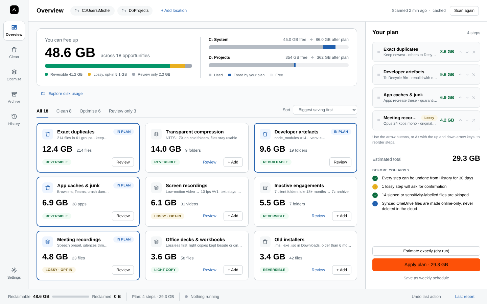
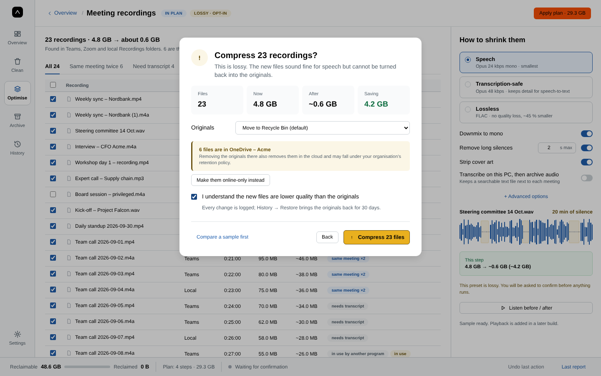
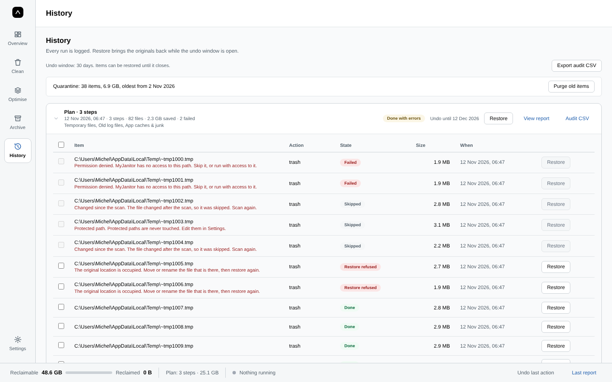
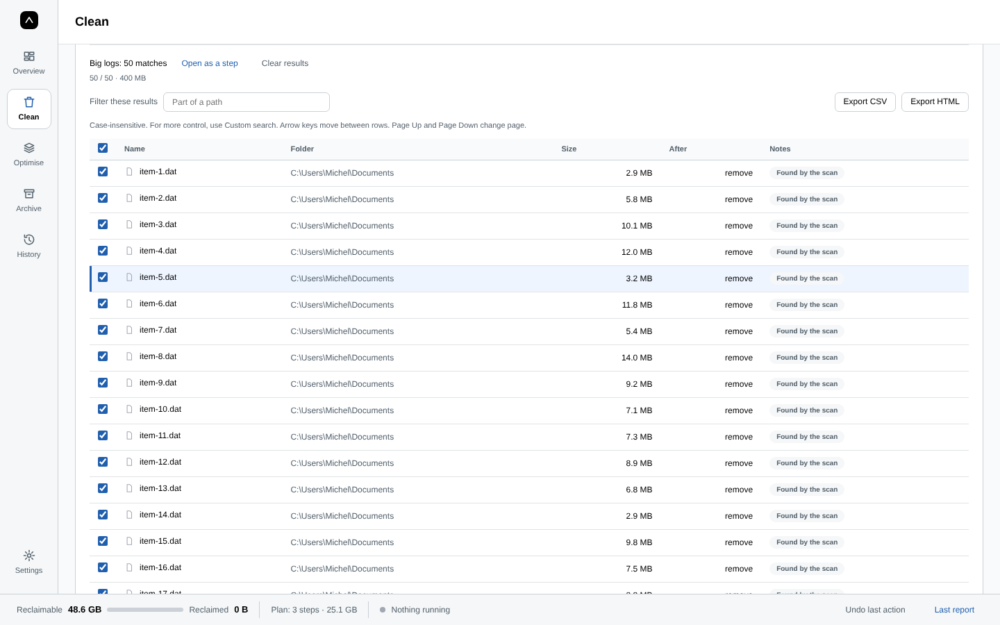
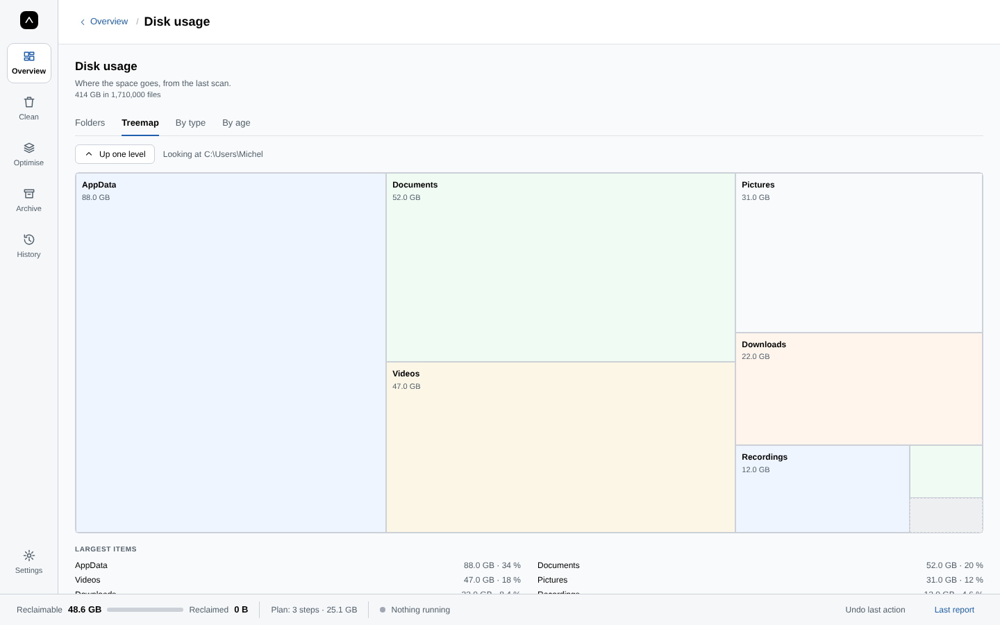

# MyJanitor

MyJanitor is a desktop app for Windows 10/11 (x64) and Linux (x64) that finds files you can clean up and makes the rest smaller. It scans folders you choose, ranks what it finds as "opportunities" (duplicates, caches, old installers, bloated Office files, large recordings and so on), and lets you build a plan from them, check the estimate, and apply it. It is written in Rust with a Tauri 2 shell, and there is a command-line twin, `myjanitor-cli`, over the same engine.

It runs fully offline, sends no telemetry, and never downloads anything.

## Safety model

- **Estimate first.** Every card and plan step shows an estimated saving. "Estimate exactly (dry run)" runs the real checks, and the real optimiser into a scratch folder, without touching your files.
- **Reversible by default.** Removals go to the system Trash (Linux) or to MyJanitor's own quarantine (Windows, see the limitations), and every change is written to a crash-safe journal before it happens. Undo and per-file restore live in History.
- **Lossy and permanent only on opt-in.** Re-encoding, deleting content inside a file and permanent delete need an explicit confirmation, and the action engine itself refuses them without one.
- **Originals stay yours.** An optimised file is written beside the original (a `_light` copy) or replaces it with the original kept aside, as you choose. An output that is not smaller is thrown away.
- **Guarded paths.** Protected system folders, MyJanitor's own folders, symlinks and mount points are never acted on. Signed, encrypted and sensitivity-labelled files are skipped and reported.
- **A failed read never looks like "nothing found".** Unreadable files are counted and reported.

## Screenshots

These were rendered with the built-in mock backend and sample data (the `C:\Users\Michel` paths are fixtures), not from a real scan.

| | |
|---|---|
|  |  |
| Overview: ranked opportunity cards and "Your plan" | Step review with the lossy confirmation dialog |
|  |  |
| History: runs, restore and undo | Custom search: quick query, rule builder and presets |
|  | |
| Disk usage: folder tree and treemap | |

## What it does

The full list is in [`docs/FEATURE-STATUS.md`](docs/FEATURE-STATUS.md): 163 catalogued features, of which **92 are done, 45 partial, 17 shown disabled with a reason, and 9 not built**. Read it before relying on anything below, because each row says what works and what does not.

- **Scan.** Several folders or drives, include and exclude patterns, a parallel walk with a persistent cache (a second scan of 200,000 files takes under a second), pause and stop, allocated versus logical size, a folder tree and a treemap.
- **Find.** Filters on name, path, size, dates, attributes, owner, depth and path length; true file type versus extension; a quick-query syntax such as `ext:mp4 size:>1GB modified:<2024`; an AND/OR rule builder; saved presets; global exclusions.
- **Detectors.** Exact duplicates (size, partial hash, full hash and SHA-256), similar images (perceptual hash on JPEG and PNG), version chains, derived files, empty files and folders, zeroed and broken files, temporary files, app caches, developer artefacts, old installers, orphan sidecars, language packs, stale files, inactive project folders, duplicate fonts.
- **Actions.** Trash, quarantine with restore, move and copy, permanent delete (confirmed), hard-link and reflink replacement of duplicates, undo of every operation, run reports and an audit CSV.
- **Optimise.** Lossless PNG and JPEG rewrites; PowerPoint, Excel and Word package optimisation (unused layouts, duplicate media, custom XML, notes, hidden slides, used ranges and more, most of it opt-in); lossless PDF structural optimisation; ZIP repack for EPUB, CBZ, JAR and ODF; ZIP archiving of cold folders with a mandatory integrity test and a searchable index; file-system compression (NTFS WOF and Btrfs zstd); video, screen-recording and audio optimisation through ffmpeg.
- **Automate.** The CLI, scheduled profiles (reversible steps only), file-manager context-menu entries, portable mode, thread count setting.

Several optimisations are shown disabled because they need an image codec, a font subsetter or an external program that is not bundled. See "Known limitations".

## Requirements

| | |
|---|---|
| Rust | The workspace declares `rust-version = "1.88"`. The GUI (Tauri 2.12.3) needs 1.90 or newer according to the CI notes, and CI builds with 1.92.0, which is what is tested. |
| Node.js 22 | Only for the UI tests (`node --test ui/`) and the optional browser preview. The app needs no Node at run time and the UI has no build step. |
| Linux packages | For the GUI, as CI installs them (Ubuntu 22.04): `libwebkit2gtk-4.1-dev libgtk-3-dev libayatana-appindicator3-dev librsvg2-dev libsoup-3.0-dev build-essential pkg-config libssl-dev file patchelf xdg-utils`. The CLI and the library crates need only a Rust toolchain. |
| Windows | The Microsoft WebView2 runtime (part of Windows 11, installable on Windows 10) and the MSVC build tools ("Desktop development with C++"). |
| Bundling | `cargo install tauri-cli --version "^2" --locked`. The Windows installer is built with NSIS, which Tauri downloads at build time. |

## Build and run

```
# GUI (debug): opens the window, nothing is scanned until you press Scan
cargo run -p myjanitor

# GUI, release binary and installers
cargo tauri build --bundles deb,appimage      # Linux
cargo tauri build --bundles nsis              # Windows
# binaries: target/release/myjanitor and target/release/myjanitor-cli

# CLI
cargo run -p mj-cli -- --help
cargo build --release -p mj-cli               # target/release/myjanitor-cli
```

The GUI accepts `--data-dir <dir>` (keep every MyJanitor folder under one root, handy for trying it out), `--optimise <path>` and `--duplicates <path>` (open with that folder as the scope; nothing runs until you press Scan).

**The UI in a browser, on fake data.** The UI is plain ES modules. `node ui/dev/serve.mjs` serves it at `http://127.0.0.1:5173/?mock=1` with a mock backend and no real files. Useful query options: `scenario=empty|fresh|results|rich`, `speed=0.5`. The screenshots above were made this way (`ui/dev/screenshots.mjs`, which needs Playwright installed separately).

## Test

The five gates, run after every merge:

```
cargo fmt --all --check
cargo clippy --workspace --all-targets -- -D warnings
cargo test --workspace
node --test ui/
cargo check --workspace --target x86_64-pc-windows-msvc    # Windows cross-check, needs: rustup target add x86_64-pc-windows-msvc
```

At the documented commit: 749 Rust tests and 211 UI tests pass, 2 Rust tests are ignored (below), `cargo fmt --check` is clean and the Windows cross-check finishes without errors. The Windows check compiles the whole workspace including Tauri but links and runs nothing. Tests build their own trees in temporary folders and never touch real data.

Some media tests run against the real `ffmpeg` and skip themselves, with a message, when it is not on `PATH`.

**Ignored performance tests** (large synthetic trees, run on demand):

```
# scan only: 200,000 files, cold and warm (MJ_PERF_FILES changes the count)
cargo test -p mj-scan --release --test perf -- --ignored --nocapture

# whole engine: scan, detectors, plan, dry run, rescan, memory
CARGO_INCREMENTAL=0 MJ_TEST_WAIT_SECS=900 cargo test --profile ci -p mj-engine --test perf_large -- --ignored --nocapture
```

`MJ_WRITE_UI_FIXTURES=1 cargo test -p mj-engine --test ipc_shapes` regenerates the real-engine responses the UI tests replay.

## CLI quick start

State lives in the data folder. `--data-dir DIR` on every command keeps all of it (settings, journal, cache, quarantine) under `DIR`, which is a good way to try things out. Replace the placeholder paths with your own.

```
myjanitor-cli scan /path/to/Downloads            # read-only; remembers the folder
myjanitor-cli list                               # opportunities, biggest saving first
myjanitor-cli show det:exact_duplicates          # the files behind one of them
myjanitor-cli plan add det:exact_duplicates      # put it in the plan (default action: to Trash)
myjanitor-cli plan show
myjanitor-cli dry-run                            # exact estimate, changes nothing
myjanitor-cli apply                              # asks you to type APPLY on a terminal
myjanitor-cli history                            # past runs and how long each can be undone
myjanitor-cli undo --last                        # put everything from the last run back
```

Things to know:

- `scan` refuses the root of a file system or drive, your home folder, and any folder that contains MyJanitor's own data or cache folder. Choose a folder inside them.
- Each command re-reads the last scope (the cache makes that quick) and replays the stored plan; `clean <folders> --detectors a,b [--dry-run|--apply]` does it all in one process.
- `apply --yes` skips the typed confirmation, but lossy steps still need `--confirm-lossy` and permanent ones `--confirm-permanent`. `--originals trash|quarantine` chooses what happens to originals.
- Other commands: `search "<query>" <folders>`, `report [--format text|csv|html] [-o FILE]`, `schedule`, `run-profile`, `context-menu`, `tools`, `settings get|set`, `cache info|clear`, `info`. Add `--json` for the engine's JSON. Exit codes: 0 ok, 1 error, 2 usage, 3 finished with some failed items.

## Optional external tools

MyJanitor works without any of these. It looks for them on `PATH`, never downloads them, and shows the matching features disabled with the reason when they are missing. Override a location with `myjanitor-cli settings set tool_paths.<id> <ABSOLUTE-PATH>`; `myjanitor-cli tools` shows what was found.

| Tool | Enables |
|---|---|
| `ffmpeg`, `ffprobe` | Video, screen-recording and audio/meeting-recording optimisation; waveform preview |
| `cwebp`, `avifenc`, `cjxl` | Photos (lossy): conversion to WebP, AVIF, JPEG XL |
| `oxipng`, `jpegtran` | Optional extra engines for lossless PNG and JPEG (the built-in passes work without them) |
| `7z` | 7z archives |
| `zstd` | `tar.zst` archives |
| `gifsicle` | Detected only; there is no GIF optimiser yet |

Only ffmpeg was run for real during development. The others are checked by argument tests, so treat them as untested.

## Data locations and portable mode

| | Windows | Linux |
|---|---|---|
| Settings, presets, schedules, journal, quarantine | `%LOCALAPPDATA%\MyJanitor` | `$XDG_DATA_HOME/myjanitor` or `~/.local/share/myjanitor` |
| Scan cache and scratch files | `%LOCALAPPDATA%\MyJanitor\cache` | `$XDG_CACHE_HOME/myjanitor` or `~/.cache/myjanitor` |

**Portable mode:** put an empty file named `portable` (or `myjanitor.portable`) next to the executable and everything goes under `<executable folder>/data`. Nothing is written to the registry or to the file manager in that mode.

The GUI and the CLI share these folders, so a second GUI instance on the same data folder refuses to start. Set `MYJANITOR_NO_OS_INTEGRATION=1` to stop any scheduler or context-menu registration. Registering a schedule or the context menu is always an explicit step (`schedule install`, `context-menu install`, or the Settings toggle for the menu).

## Project layout

| Path | What it is |
|---|---|
| `crates/core` | Domain types, error model, IPC contracts, in-house hashing, glob, time, thread pool |
| `crates/platform` | Platform abstraction and hand-written FFI for Windows and Linux (scan metadata, trash, links, compression, cloud files) |
| `crates/scan` | Directory walker, file index, scan cache, folder tree |
| `crates/dupes` | Exact duplicates, similar images, version chains, derived files, duplicate fonts |
| `crates/filters` | Metadata filters, rule engine, presets, quick-query parser, file-type sniffer |
| `crates/detect` | The simple cleaning detectors |
| `crates/actions` | Action engine, journal, undo, quarantine, guard, protected paths, safety detection, reports |
| `crates/formats` | In-house parsers and writers: ZIP, XML, OOXML, PDF, PNG, JPEG, EXIF, CFB, media headers |
| `crates/optimise` | Optimisation framework and the optimisers, archiver, external-tool adapters |
| `crates/engine` | The facade the GUI and CLI call: sessions, scan orchestration, plan, jobs, history, settings, schedules |
| `crates/cli` | `myjanitor-cli` |
| `src-tauri` | The Tauri shell and the `myjanitor` binary |
| `ui` | The web UI: plain ES modules, no bundler; `ui/dev` has the preview server |
| `docs` | Architecture, IPC contract, decisions, dependencies, feature status, review |

See [`docs/ARCHITECTURE.md`](docs/ARCHITECTURE.md), [`docs/IPC.md`](docs/IPC.md), [`docs/DECISIONS.md`](docs/DECISIONS.md) (with an index of every workstream's decisions), [`docs/DEPENDENCIES.md`](docs/DEPENDENCIES.md) and [`docs/STATUS.md`](docs/STATUS.md).

## Known limitations

**Windows has never been run.** The whole workspace, Tauri included, is compile-checked for `x86_64-pc-windows-msvc` from Linux, and Windows-specific parsers are unit-tested on hand-built data, but no feature was exercised on a Windows machine. This covers the NTFS fast index, cloud placeholder handling, the Recycle Bin route, WOF compression, OneDrive "free up space", `.lnk` shortcuts, `schtasks` and registry integration. The CI workflow builds and tests on Windows, but its first run is unproven.

**On Windows, "Recycle Bin" means the MyJanitor quarantine.** The Windows API returns no handle to a recycled item, so an exact restore is not possible. The default reversible route is therefore a quarantine folder inside the data folder, restorable from History. The real Recycle Bin route exists in code, with a best-effort restore, but no setting exposes it. The GUI wording still says "Recycle Bin" on that route. On Linux the real freedesktop Trash is used with exact restore.

**Quarantine is not emptied automatically.** Items stay until you press "Purge old items" in History. The retention days only decide which items that button removes, and the CLI has no purge command. Space is not freed while items sit in the quarantine or the Trash.

**Disabled until a tool, codec or Windows is available:**

- PDF image downsampling, PDF font subsetting and the PDF presets (no image codec or font subsetter is bundled).
- PowerPoint, Word and Excel picture compression and cropping, picture editing history, chart-to-picture, EMF/WMF conversion, object-to-picture, font subsetting, `.xlsb` conversion, embedded media re-encoding.
- Lossy image conversion and resize without `cwebp`, `avifenc` or `cjxl`; video and audio without `ffmpeg`.
- 7z and `tar.zst` archives without `7z` or `zstd`; archive encryption and split volumes are disabled everywhere.
- File-system compression needs NTFS on Windows or Btrfs on Linux; the background recompression watcher is not built.
- Not built at all, with no UI entry: similar videos, same music, duplicate meeting recordings, secure shred, free-space wipe, SQLite vacuum, mailbox and virtual-disk compaction, executable packing.

**Verified on generated fixtures only.** Office, ZIP and PDF edits are checked structurally (well-formed XML, intact relationships, CRCs, byte-identical untouched parts) and by round trips, but optimised files were never opened in Microsoft Office. The PDF pass was run over a corpus of 34 PDFs; 9 were skipped as encrypted or malformed.

**Smaller gaps:**

- Content search reads plain text only; PDF, Word and Excel text is not searched (such files are reported as unavailable, not as "no match"). Media-metadata conditions have no query key or UI field.
- Owner is `uid:N` on Linux and not collected on Windows.
- Hard-link and reflink replacement and keep-folder-structure are available through the CLI or engine only; the GUI offers Trash, quarantine, move and permanent delete.
- The settings for low-memory mode, the temporary folder (in the GUI), CPU priority and parallel jobs are stored and validated but do not change behaviour yet. Jobs that change files run one at a time.
- OS scheduler registration is done from the CLI, and was tested with a fake runner only. Schedule times ignore daylight saving.
- Similar-image detection does not decode HEIC, RAW or WebP.
- Plan steps are reordered with arrow buttons, not by dragging.
- Light theme only. The palette has no dark variant.
- The in-app folder browser replaces the native folder dialog.
- Undoing an archive leaves its sidecar index file behind.
- Peak memory on a 200,000-file test was 1.6 GiB, inflated by the test's event recorder; it was not measured separately.

## Security review status

An adversarial review of every destructive code path is in [`docs/review/adversarial-review-1.md`](docs/review/adversarial-review-1.md): 20 findings (1 critical, 3 high, 7 medium, 9 low). The most important ones: protected paths are checked on the item but not below it, so a folder action can remove protected files inside a folder; "Select all" on a duplicate group can check the keeper too; a folder that changed after the scan is removed with its new content. Fixes were being applied in a separate pass when this README was written. Their status, and any finding accepted instead of fixed, is tracked in `docs/review/` and `docs/DECISIONS.md`. Until that pass is merged, keep the default reversible routes, and keep your own backups of anything that matters.

## Licence

MIT. See [`LICENSE`](LICENSE).
